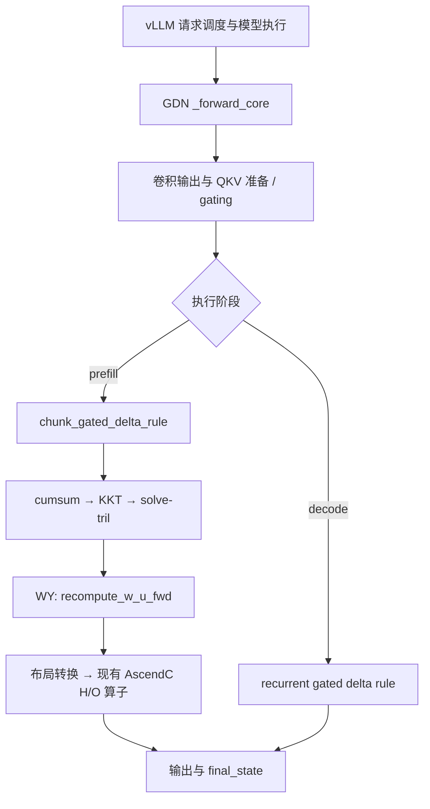
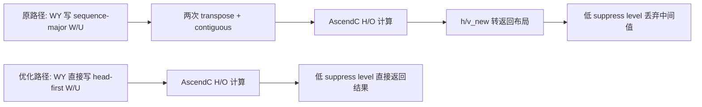

# 从源码调查到 NPU 验证：910B2 上的 GDN 推理优化复盘

记录日期：2026-10-15。本文说明项目为什么做、用了哪些技术、如何发现问题、如何实施和验证，以及哪些结论目前还不能下。原始结果以 [报告 10](../reports/10_gdn_operator_optimization.md)、[报告 11](../reports/11_gdn_length_specialization.md) 和对应 JSON 为准。

本项目已经完成 **WY 等长索引 Bug 的社区修复回移、GDN 布局优化的独立复现，以及融合 prepare 的 shape/graph 组件筛选**。布局方案在所测 8K prefill 负载中取得约 3.2%–4.0% 的模型吞吐收益。融合 prepare 与布局方案的整模型组合 A/B 尚未完成；目前没有一个对所有长度默认启用的生产分派器。

## 1. 背景：为什么研究这个问题

目标是在一张租用的 Ascend 910B2 64GB NPU 上，找到规模可控、能复现和解释的推理性能问题。资源边界是单卡、有限显存和卡时，不能默认多卡训练、无限预算或重写完整 Attention/GDN 算法。

项目最初以 Qwen3-8B 文本推理为基线，调查 Graph bucket/padding、Runtime、Scheduler 和历史 Issue。随后建立独立的 0.26 环境，转向 Qwen3.5-4B 的 GDN 算子路径。这两个模型和两套环境需要分别记账：GDN 的收益不能直接算到 Qwen3-8B 上。

早期探索提供了选题依据，也明确了止损点：

| 早期方向 | 得到的证据 | 对后续工作的影响 |
| --- | --- | --- |
| Graph bucket/padding | 观察到 5 个请求 padding 到 8；增加精确 bucket 后 E2E P50 仅改善约 0.63% | 能观察到冗余，不代表值得继续投入；见 [报告 03](../reports/03_graph_bucket_profile.md) |
| PA workspace cache | 回移有收益，但社区已有对应实现 | 保留为社区复现，纠正原创判断；见 [报告 05](../reports/05_runtime_atb_profile.md) |
| #16637 动态投机解码 | 实际版本的配置保护仍选择 PIECEWISE；候选普通负载没有进入 padding 分支 | 不把分组噪声当成补丁收益 |
| #15920 长上下文 | 旧模型 mask 路径和原 Issue 不同；历史 profile 请求数改动不能证明修复原 OOM | 撤回“已修复”判断，见 [报告 09](../reports/09_current_environment_and_026_ab.md) |

进入算子阶段后，研究范围收敛到两个成本：**中间张量布局转换带来的搬运，以及 prepare 阶段多个小操作带来的发射开销**。这两类成本可以在有限文件内修改，并用数学参考和原生 profiler 验证，不需要重新实现完整 GDN。

## 2. 技术栈：每一层具体负责什么

### 2.1 固定运行环境

| 层级 | 本轮版本/配置 | 在项目中的作用 |
| --- | --- | --- |
| 硬件与系统 | Ascend 910B2 64GB，aarch64 / openEuler，驱动 26.1.1 | 实际执行和 profiling；进程内使用逻辑 `npu:0`，物理卡号不作为迁移配置 |
| Python | 3.11.15，独立 venv | 隔离实验依赖，避免覆盖原来的 0.22 环境 |
| vLLM | 0.26.0，`568afb3a13806beb53bb2e6bd518269357b237c0` | 请求调度、batching、模型执行、worker 和 graph 配置 |
| vLLM-Ascend | 0.26.0rc1，`f2f74a16c3c50a76f4349d807918e83edec1e35c` | 昇腾平台适配、GDN 调用链、Triton/AscendC 对接 |
| PyTorch / torch-npu | 2.10.0+cpu / 2.10.0.post4 | Tensor、CPU 参考、NPU stream/event/graph、profiler |
| Triton Ascend | 3.2.2 | WY 的索引与输出布局；融合 prepare 的编译和 tiling 实验 |
| CANN / 910B ops | 9.1.0 | 设备运行时、算子库和原生性能分析基础 |
| ATB | 9.1.0 | 已加载的软件栈组成；本轮没有改写 ATB 算子 |
| 模型 | Qwen3.5-4B，BF16，文本路径，TP=PCP=1 | 已下载并验收的 GDN 模型；本轮无 MTP、量化或图像/视频输入 |
| 相关依赖 | Transformers 5.14.1，NumPy 1.26.4 | 模型配置、tokenizer 和实验依赖 |

软件包名中的 `torch+cpu` 不代表推理在 CPU 上执行：NPU 后端由配套 torch-npu 和 Ascend 插件提供。vLLM 使用 `VLLM_TARGET_DEVICE=empty` 从固定源码安装，避免装入 CUDA 后端依赖。安装来源、国内镜像和实际限制见 [0.26 恢复说明](stack026_reproduction.md)。

环境验收还检查实际模块的 `__file__`：editable 安装可能被旧包路径遮蔽，不能只看 `pip list` 就认定正在运行新代码。当前离线 BF16 引擎已验收，但 FastAPI 等依赖 metadata 存在冲突，不能称为全套前端与可选功能均已通过兼容性检查。

### 2.2 实际使用的工程工具

| 工具/机制 | 用来解决的问题 | 对应产物 |
| --- | --- | --- |
| 源码搜索、GitHub Issue/PR、固定 commit diff | 确认真实路径、社区覆盖、版本差异 | upstream audit JSON、源码快照、原始 PR patch |
| Triton Ascend 指针/stride/constexpr/launch grid | 修正 B/H/T 索引，改变输出布局，比较 BLOCK_T | 两份源代码 patch、隔离模块生成器 |
| 已有 AscendC 自定义算子 | 消费 head-first w/u，计算 chunk state 和输出 | 核对布局契约；没有编写新的 AscendC 数学算子 |
| 独立 CPU PyTorch FP32 参考 | 避免只用“两个版本相等”掩盖共同错误 | WY 矩阵参考、完整 GDN 递推参考、prepare 参考 |
| pytest / Ruff / 语法检查 | 源码回归及交付质量 | 12 个源码 NPU 参数化用例及定向检查日志 |
| vLLM 自定义 worker / collective RPC | 在同一 warm engine 内切换待测实现 | A/B harness、实际调用次数与 token shape 记录 |
| NPU Event / stream / NPUGraph | 计时、显式同步、捕获重放及输入更新验收 | event/wall samples、graph 正确性记录 |
| torch_npu.profiler / msprof | 对照 CPU/NPU 时间线、设备任务、拷贝和内存 | Torch trace、CSV、原生 msprof 导出与返回码 |
| Python JSON/CSV 分析、Matplotlib | 汇总全部 case 和回退，展示消融 | summary JSON、[对比图](../evidence/gdn_operator/operator-comparison.png) |
| Git commit / patch / bundle / SHA256 / tar | 保留源码历史、数据和换实例后的恢复能力 | 分离提交、校验 manifest、恢复验收日志 |

昇腾实验中的时间线和算子分析由 torch_npu.profiler 与 msprof 承担；NVIDIA 的 nsys/ncu 不在本轮已执行的分析工具中。拥有 trace 也不等于拥有所有硬件计数：布局实验采集了 Level1/PipeUtilization，prepare 实验使用默认 profiler level，后者不宣称采到完整 AIC 利用率指标。

## 3. 先理解模型：GDN、prefill 和 decode

Qwen3.5-4B 是混合注意力结构。官方 [config.json](https://huggingface.co/Qwen/Qwen3.5-4B/blob/1eef1f4e0bc57dec8f814d1e4c714c8e0065d261/config.json) 列出 32 层中的 24 个 linear-attention 层与 8 个 full-attention 层；线性部分的 key heads 为 16、value heads 为 32，key/value head dim 均为 128。这些数值解释了本轮 H/Hg/D 的测试选择。实际下载权重的逐文件版本另保存在 [模型 manifest](../evidence/stack026/qwen35-modelscope-files.json)，不是将网页 main 当作本机权重版本。

GDN（Gated DeltaNet）维护每个 head 的矩阵状态。以下按本项目 [CPU 递推参考](../scripts/benchmark_gdn_operator.py) 的 `S[K,V]` 约定，省略 batch/head 维；q/k 已完成归一化：

$$
\begin{aligned}
\widetilde S_t &= \exp(g_t)S_{t-1}, \\
r_t &= v_t-k_t^\top\widetilde S_t, \\
S_t &= \widetilde S_t+\beta_t k_t r_t^\top, \\
o_t &= (q_t/\sqrt{D_k})^\top S_t.
\end{aligned}
$$

这段递推用于说明和验证语义，不是本项目提出的新算法。key/value head 数不同时，参考代码先按分组关系扩展 q/k。GPU/NPU 上的 chunk 实现用分块矩阵计算获得相同结果；WY 产生的 W/U 是这一分块流水线的中间量，不是模型权重文件。

- **Prefill** 一次处理多个输入 token，chunk 流水线中的矩阵计算和大张量搬运较明显。
- **Decode** 通常每个请求每步产生一个 token，走 recurrent 路径；短操作发射、图重放和 batch 大小的影响不同。
- **Chunked prefill** 会把长请求拆成几步；多个短请求又可能合到同一步。因此 kernel 的 T 是当前算子处理的 token 数，不等于某个请求的总 prompt 长度。

这也是不能用一条“请求超过 8K 就换 kernel”的规则直接覆盖所有场景的原因。

## 4. 从真实调用链找到候选成本

对固定 0.26.0rc1 源码，先找到 [ops/gdn.py](https://github.com/vllm-project/vllm-ascend/blob/f2f74a16c3c50a76f4349d807918e83edec1e35c/vllm_ascend/ops/gdn.py) 的 `_forward_core`，再跟到 [chunk.py](https://github.com/vllm-project/vllm-ascend/blob/f2f74a16c3c50a76f4349d807918e83edec1e35c/vllm_ascend/ops/triton/fla/chunk.py) 和 [wy_fast.py](https://github.com/vllm-project/vllm-ascend/blob/f2f74a16c3c50a76f4349d807918e83edec1e35c/vllm_ascend/ops/triton/fla/wy_fast.py)。



KKT/solve 内部仍有硬件 adaptor；不能因为看到 DeviceOperator 就假设整条 GDN 已经走另一套 fused CANN 算子。本轮布局实验命中的是上述 Triton + AscendC 路径，worker 计数和模型 profiler 用来检查修改确实执行了。decode 的 recurrent kernel 没有被 WY 补丁替换。

源码上得到三个待验证的观察：

1. WY 的等长路径里存在未定义的 chunk 索引及不正确的 batch 偏移，需要最小用例验证。
2. WY 写出 `[B,T,H,D]`，下游 AscendC 又要求连续 `[B,H,T,D]`；同时有返回前转换完又丢弃的中间值。
3. prepare 链包含拆分/拷贝、两次 q/k norm 与 gating，可能有可合并的发射开销。

此时只能称为候选。到底是否耗时、是否进入目标分支，以及能否影响模型，要继续靠实验回答。

## 5. 实验前先核查社区，区分贡献来源

流程固定为：**源码搜索 → Issue/PR 搜索 → 当前主线比对 → 决定是否实验**。每条候选记录实际版本、PR 状态及 head/base SHA；“open”不等于可直接使用，“merged”也不等于本机运行时已经启用。

| 方案 | 社区来源 | 本项目实际完成的部分 |
| --- | --- | --- |
| WY 等长索引修复 | [#14333](https://github.com/vllm-project/vllm-ascend/pull/14333) | 回移到固定 0.26 基线，构造独立参考和 B=2 回归 |
| WY 直接输出 head-first | [#16538](https://github.com/vllm-project/vllm-ascend/pull/16538) | 与索引修复组合，检查输出布局、PCP guard 和返回契约 |
| 跳过 suppressed 中间值转换 | [#16524](https://github.com/vllm-project/vllm-ascend/pull/16524)，与 #16538 重叠 | 单独消融，不重复累计两份收益 |
| prepare 融合 | [#17604](https://github.com/vllm-project/vllm-ascend/pull/17604) | 固定 PR 源码的独立复现、BLOCK_T 筛选、CPU/graph 检查 |
| 较小范围 host 优化 | [#16811](https://github.com/vllm-project/vllm-ascend/pull/16811) | 调查替代方案；没有声称已完成其模型 A/B |
| head 展开到 launch grid | 阅读相关 grid/FLA PR 后做的独立小实验 | 未达到稳定 3% 门槛，停止；不宣称通用并行方法是新算法 |

上表五个编号 PR 在 2026-10-15 本次核对时均未合并。更完整的状态与快照见 [布局 audit](../evidence/gdn_operator/upstream-audit.json) 和 [分区 audit](../evidence/gdn_dispatch/upstream-audit.json)。搜索有范围限制，不能用“没搜到”等价于“全社区都没有”。

本项目的工程贡献主要是 **固定旧栈回移、组合兼容、独立数学参考、多层验证、负向结果分析和可恢复交付**，不把已有社区设计包装成原创 GDN 算法。

## 6. 问题一：先把正确性 Bug 单独修复

### 6.1 怎么复现

原 WY kernel 的 `i_t` 在变长分支内赋值，等长分支随后仍使用它。设置 `cu_seqlens=None` 后，未修改基线在 Triton 编译阶段报 `NameError: i_t`。这比直接跑整模型更容易隔离问题。

此外，原循环用 `i_bh in range(H)` 再计算 `i_b=i_bh//H`，因此循环里的 batch 始终为 0；对等长多 batch，不能正确利用 launch grid 的 batch 维。beta/g 已被转置为 head-major，其 batch 起点也应按 `b*H*T` 计算，不能只加 `b*T`。

### 6.2 怎么改，为什么这样改

按 #14333 的思路，在等长分支从 `tl.program_id(1)` 取 batch，从当前 program 取 chunk；把 head 遍历和 batch 索引拆开，统一 g/beta 的正确起点。packed 路径仍使用 `cu_seqlens` / chunk metadata。

为避免两个 batch 恰好相同而掩盖越界或重复读取，源码回归用 B=2、T=96（跨 64-token chunk 且有尾块），为两个 batch 设置不同的 beta/g，并令 A 为分块单位矩阵。这样 W/U 的预期结果可以直接算出，不依赖另一个相似 kernel 作参考。测试见 [test_wy_source_regression.py](../scripts/test_wy_source_regression.py)，修改见 [修复 patch](../patches/gdn_wy_equal_length_026.patch)。

24 组 shape/dtype 测试中，stock 的 18 组 packed 用例通过、6 组等长用例失败；修复版本全部通过。后续源码恢复 worktree 中又运行了 12 个参数化 NPU 回归，包含两种输出布局。

**该 Bug 修复不能解释模型吞吐收益。** 本轮 Qwen3.5 模型走 packed 路径；修复是独立的正确性成果，性能改动另做消融。

## 7. 问题二：让生产者直接写出消费者需要的布局

### 7.1 为什么几行布局代码可能很贵

对普通 strided tensor，`transpose` 通常只改变 view/stride；转置后再调用 `contiguous()`，如果目标布局不连续，就要实际复制数据。官方语义见 [PyTorch transpose](https://docs.pytorch.org/docs/2.10/generated/torch.transpose.html) 与 [contiguous](https://docs.pytorch.org/docs/2.10/generated/torch.Tensor.contiguous.html)。因此不能简单说“所有 transpose 都做了一次拷贝”，要看后续消费和 profiler。

0.26 的这条链里，WY 先输出 sequence-major W/U，再复制成 head-first 给 AscendC。另一方面，h/v_new 已在工作布局被输出算子使用，随后又被转换为返回布局，最后因 `SUPPRESS_LEVEL<3` 返回 `None`。



这里只去掉不必要的格式转换，h/v_new 的数学计算和被输出算子使用的过程仍然保留。

### 7.2 怎么实现

在 WY 增加编译期 `HEAD_FIRST_OUTPUT` 选项和对应输出分配。以等长连续 tensor 为例，同一元素的扁平地址从：

```text
sequence-major [B,T,H,D]: (((b*T + t)*H + h)*D + d)
head-first     [B,H,T,D]: (((b*H + h)*T + t)*D + d)
```

变成直接按后一种地址写出。数学中的 A、k、v、beta、g 和矩阵乘顺序不变。packed 的起点与边界另按 metadata 处理，并用空段/尾块用例检查，不能把上面的等长公式直接套到所有输入。

chunk 侧在单卡 PCP=1 且 `SUPPRESS_LEVEL<3` 时使用 head-first，跳过 W/U 转换；把 h/v_new 的返回格式转换移入确实需要返回它们的分支。PCP>1 仍保留原来需要的 sequence-major，`SUPPRESS_LEVEL>=3` 的中间值返回契约也保留。单卡只验证了 guard 和单卡返回行为，没有冒充多卡实机验收。实现见 [性能 patch](../patches/gdn_head_first_026.patch)。

### 7.3 用消融回答“收益到底来自哪”

使用四组实现：stock、仅等长修复、仅省略不返回的转换、组合 head-first。相同 BF16 输入、同一预建 metadata，六轮交错，每轮三次；排除初始化和首次编译。

| T | stock | 仅索引修复 | 仅省略返回转换 | 组合 head-first |
| ---: | ---: | ---: | ---: | ---: |
| 2048 | 2.432 ms | 2.435 ms | 2.329 ms | 2.250 ms |
| 8192 | 5.788 ms | 5.795 ms | 5.442 ms | 5.251 ms |
| 32768 | 22.058 ms | 22.017 ms | 20.655 ms | 19.693 ms |

这是单层完整 GDN pipeline 的 NPU event span，包含 host 发射间隙，不是单个 kernel 的设备时间。32K 耗时降低 10.73%，换算成相同工作量的速率提升是约 12.01%；两种百分比不能混用。原始数据见 [gdn-pipeline.json](../evidence/gdn_operator/gdn-pipeline.json)。

原生 profiler 给出另一层证据：32K 三次调用中，设备任务从 72 降至 60，transpose 从 36 降至 24，transpose 时间合计从 10.055 ms 降至 3.110 ms；WY 自身的合计时间约 17.13/17.16 ms，基本不变。对应每次调用减少四个转换，符合代码预期。[profile-summary.json](../evidence/gdn_operator/profile-summary.json) 保留了设备数据。

按这些 BF16 目标 shape 计算，省掉的 W/U/v_new 各 256 MiB、h 512 MiB，合计每层 1.25 GiB 的复制输出；若按同精度数据各读写一次估算，约为 2.5 GiB 搬运。这个数是 shape 推算，不是 HBM 总线计数实测，也没有覆盖全部 cast/workspace 成本。它解释了为什么源码只改少量索引和分支，也可能影响大量数据。

## 8. 如何证明正确，而不只是“跑通”

验证分为五层，每层回答不同的问题：

| 层次 | 检查方法 | 已得到的结论 |
| --- | --- | --- |
| WY 局部数学 | 独立 CPU FP32 分块矩阵参考；BF16/FP32、等长 B=2、packed、空段、尾块、不同 K/V dim | 修复与 head-first 的 24 组用例通过 |
| 完整 GDN | CPU 逐 token 递推，与输出和最终 state 比较，检查输入 state 未被改写 | 四实现 × `[64]` / `[64,128]` 共八项通过，最大绝对误差约 `4.10e-5` |
| 大 shape 一致性 | 2K/8K/32K 完整 pipeline 多实现比较 | 输出和最终 state 逐元素相同 |
| API/布局契约 | `SUPPRESS_LEVEL=0/3`、输出 shape/contiguous；恢复源码后 NPU pytest | 八项返回契约检查通过，源码 12 个参数化测试通过 |
| 模型生成 | 固定 token IDs、greedy、首 token logprobs、完整生成序列、stock-only 控制 | eager 与固定 batch 图模式一致；默认异步 graph 仍有基线波动，见下一节 |

参考实现只在小 shape 上逐 token 跑，以控制 CPU 验证成本。大 shape 逐元素一致是补充证据，不能代替独立参考；BF16 检查使用明确容差，也不把容差内相等说成 bit-exact。

## 9. 从局部提速走到整模型 A/B

局部收益不会自动等比例传到模型。投影、卷积、全注意力层、MLP、采样和调度都仍然存在。若待优化部分占总时间 f、局部提速倍数为 s，则理想总提速上限受 `1 / ((1-f)+f/s)` 约束；真实系统还会受重叠、内存和调度影响。因此必须测模型 wall time，并核对路径命中。

### 9.1 怎么控制变量

在同一 warm engine 中，通过 [实验 worker](../scripts/gdn_experiment.py) 的 collective RPC 切换 `chunk_gated_delta_rule_fwd`。不是启动两个配置不同的服务再拿最终数字比较，也不更改已安装生产文件。wrapper 记录 variant、实际 token shape 和调用数，避免“补丁没有进入目标分支但计时变化了”的错误。

[模型 harness](../scripts/benchmark_gdn_engine.py) 固定：Qwen3.5-4B BF16、TP=PCP=1、max_model_len=33024、max_num_batched_tokens=32768、max_num_seqs=8、显存比例 0.8、prefix cache 关闭、chunked prefill 开启；本轮无 MTP。固定 prompt token IDs、greedy/seed/输出长度，预热两组全部 shape，再执行 `A B B A B A A B`，每种负载每组四次。

eager、默认异步 FULL_DECODE_ONLY、同步/固定 batch FULL_DECODE_ONLY 分别在各自配置内比较 A/B，不把调度模式之间的差异算作算子收益。图捕获 bucket 为 `[1,2,4,8]`，本轮没有宣称 prefill 已经命中大 token 图。

### 9.2 把收益与回退一起报告

以下是相同工作量的模型吞吐中位数比值，见 [summary.json](../evidence/gdn_operator/summary.json)。输出 1 token 的行用于 prefill/首 token 研究：

| 输入 / 并发 / 输出 | eager 异步 | Graph 异步 | Graph 固定 batch |
| --- | ---: | ---: | ---: |
| 2K / 1 / 1 | +1.83% | +2.81% | −4.66% |
| 8K / 1 / 1 | +3.99% | +3.56% | +3.32% |
| 32K / 1 / 1 | +2.85% | +3.11% | +2.93% |
| 8K / 4 / 1 | +3.21% | +3.46% | +3.43% |
| 2K / 4 / 128 | +0.34% | −2.35% | −0.76% |

因此目前可以说“8K prefill 在所测配置约有 3.2%–4.0% 收益”，不能说“所有上下文和 decode 都超过 3%”。2K 短请求的波动较大，现有数据还不能把某次回退归因于 head-first，更不能直接据此写一个固定长度阈值。

固定 batch 的 8K c1/c4 TTFT 分别降低约 3.23%/3.35%。早期 eager/异步图数据的请求 `ttft_s=null`，只能报告 workload wall time，不冒充 TTFT。四次运行也不足以可靠报告 P99、SLA 或长期稳定性。

模型 profiler 另取 8K 输入/8 输出、并发 1，看到 24 次 WY 不变，transpose 从 528 次变为 432 次，正好每个 GDN 层少四次；这说明布局变化传递到了模型。profiler 会扰动耗时，其样本不加入普通吞吐统计。

### 9.3 生成结果有差异时怎么排查

默认异步 graph A/B 中曾有一个 128-token 请求的输出不同。处理顺序是保留全部结果，再用完全未改 stock 以相同配置独立重跑，而不是先认定补丁有错或结果无关紧要。

stock-only 八轮中也出现两种输出，先前的 candidate 输出被未改 stock 完整复现。固定 batch/同步图模式的 88 个请求则全部 token 一致。可下的结论是“差异不是 candidate 独有，原因仍待定位”；不能说已证明异步图精度稳定，也不能说已修复一个 graph Bug。batch admission/shape/数值路径是后续假设，并非已证实根因。对照保存在 [graph-baseline-control.json](../evidence/gdn_operator/graph-baseline-control.json)。

## 10. 问题三：为什么继续研究融合 prepare 与不同 kernel 配置

布局优化对长 prefill 有效，但短请求和长 decode 没有稳定收益。因此下一个可检验假设是：prepare 中的多次小操作能否合并，减少 eager 的 host 发射和设备任务。

### 10.1 融合保留了什么语义

#17604 的 prepare kernel 从 packed conv 输出直接读取 q/k/v：按 head dim 做 q/k L2 norm、复制 v，同时计算：

```text
q_norm = q * rsqrt(sum(q*q, head_dim) + 1e-6)
k_norm = k * rsqrt(sum(k*k, head_dim) + 1e-6)
g      = -exp(A_log) * softplus(a + dt_bias)
beta   = sigmoid(b)
```

norm/gating 在 FP32 中计算并按原接口输出；softplus 保留阈值语义。索引子集由 kernel 内 gather a/b，避免在输出侧再逐项 index_select。将来接入模型还要关闭下游重复的 q/k norm；否则可能又归一化一次，既浪费时间又改变数值。

这些核心设计来自社区 PR，本项目复现时使用其固定 head 的源文件。它还包含 CompiledKernel 缓存、绕过常规 JIT 分派的启动路径与有限档位预编译；不能把整个融合收益都归因于数学计算加快，缓存/启动路径也参与了 eager 结果。

### 10.2 不同长度怎么选配置

PR 默认按向量核数量和 section 大小选择 BLOCK_T：低 T 用 1，本模型另一档为 2。本轮另设强制 BLOCK_T=1/4 作为控制。它们是同一 kernel 的不同编译配置，没有从头重写多个 GDN 算法。

更大 BLOCK_T 可让一个 program 一次处理更多 token，减少循环/地址计算等摊销；同时也增加片上工作集、资源压力和尾块浪费。所以“大 block 必然更快”不成立，必须比较具体 shape 和执行模式。

[prepare harness](../scripts/benchmark_gdn_prepare.py) 从固定安装源码提取真实 `rearrange_mixed_qkv` 方法作基线，再调用同栈 norm/gating，避免照 PR 文字构造一个不符合本机版本的慢基线。普通与 indexed、0/1/32/64/65/128 token 共 46 组参考检查每次均通过；随后三次独立进程做随机交错筛选。

最后一次确认的 eager **prepare 组件 event span**：

| T | 0.26 legacy | PR 默认 | BLOCK_T=4 |
| ---: | ---: | ---: | ---: |
| 1 | 0.8119 ms | 0.1453 ms | 0.1462 ms |
| 2048 | 0.8749 ms | 0.1456 ms | 0.1421 ms |
| 8192 | 0.8962 ms | 0.2454 ms | 0.2301 ms |
| 32768 | 2.3568 ms | 1.0469 ms | 0.9480 ms |

8K 的 BLOCK_T=4 相对 PR 默认耗时低 6.2%–8.4%，32K 低约 9.0%–9.4%，三个进程方向一致。2K profiler 三次调用中，legacy 有 21 个任务/305.167 us，PR 默认有 3 个任务/104.923 us；确认了七个任务合为一个，而非只看到 host 计时变化。这里的 device duration 求和与上表 event span 不是同一指标。

### 10.3 为什么还要单独测 graph

图捕获会把固定 kernel 序列记录下来，replay 省去部分逐操作 Python 工作；官方机制见 [Ascend NPUGraph 文档](https://github.com/Ascend/pytorch/blob/master/docs/zh/developer_notes/npugraph.md)。因此 eager 减少的 CPU 开销不一定在 graph 中再次出现。

两次独立图对照中，T=1 的 legacy/PR 默认约为 `0.2887/0.2852 ms` 和 `0.2863/0.2861 ms`，没有稳定达到 3%。8K 的最佳配置也与 eager 不同。单段 replay 的 host 成本会掩盖部分设备差别，这些结果不能直接推出整模型 decode 的收益或回退。

另外必须排除“图只在旧输入上正确”的假象。最新 harness 在计时后原地改变 mixed_qkv/a/b，再 replay 并对照重新计算的基线；1/65/8K/32K × 四种实现全部通过。单独验收文件为 [prepare-graph-input-updates.json](../evidence/gdn_dispatch/prepare-graph-input-updates.json)，不把其单次计时加入性能结论。

这轮只完成组件筛选，尚未完成“仅布局、仅 prepare、两者组合”的模型四臂实验。两个局部百分比不能相加，indexed 组件通过也不等于完整投机解码路径已验收。

## 11. 如何读这些性能数字

| 指标 | 测量对象 | 需要注意什么 |
| --- | --- | --- |
| kernel duration | profiler 记录的设备任务 | 求和可能与重叠及 host 空隙不同，不能直接当模型 wall time |
| NPU event span | 两个 stream event 之间的跨度，循环次数摊销 | 本项目 eager span 包含 host 发射间隙，不称为纯设备计算 |
| wall time | 完整调用/负载的主机时间 | 必须同步设备或等待完整生成，排除 warmup/编译 |
| 吞吐 | 固定工作量 / 完成时间 | 明确 input/output tokens/s 和并发；一输出 token 不代表长 decode |
| TTFT | 引擎实际请求 metrics 的首 token 延迟 | 没有 metrics 就保持 null，不从不同时间基准拼凑 |
| 峰值显存 | 记录的 allocator 指标及 npu-smi | 不把进程全局历史峰值当成每个 case 独立峰值 |

耗时降低按 `1 - t_new/t_old`，相同工作量的速率提升按 `t_old/t_new - 1`；模型汇总在样本内先算 token/s，再比较各组中位数，以 [汇总代码](../scripts/summarize_gdn_operator.py) 为准。数字相近时仍需关注噪声、测量粒度与样本量。

## 12. 失败、纠正与停止：完整流程的一部分

| 遇到的问题 | 怎样处理 | 保留的边界 |
| --- | --- | --- |
| head 展开到更多 program | 四个长度交错比较，最大差别不足稳定 3% | 停止，没有因为写了 kernel 就宣称成功 |
| T=1 且缺 prebuilt metadata 的完整 GDN 基线 AICore 越界 | 查询社区相关 #14192，双方改用模型路径的官方 metadata builder 和合法测试 shape | 未分离 shape/metadata 因素，未声称定位或修复该越界 |
| Triton 初始化、实验锚点、metrics 字段或 custom-op bootstrap 错误 | 按固定源码修正 harness，保留失败日志 | 归为本项目工具错误，不算框架 Bug 或性能样本 |
| 异步 graph 生成不一致 | stock-only 与固定 batch 控制 | 原因未定，保留限制 |
| 短请求波动或长 decode 无收益 | 全部数据一并汇报 | 不选择最佳 case 代表所有请求 |
| 上游主线继续变化 | 再读当前源码和合并 PR | 旧栈优化不自动等于最新主线的新问题 |

这套流程的关键是每次提出假设时同时写清否定条件。没有稳定收益、没有进入修改分支、或只是已经存在的社区方案，都有相应的停止或重新定位动作。

## 13. 为什么最新版不自动等于所有负载的 SOTA

vLLM 主仓库、Ascend 插件、CANN/torch-npu、模型结构和实际执行路径共同决定性能。PR 合并、进入 release、设备支持、路径命中是四件事；升级其中一个组件不能保证其他组件跟上。

本轮后一次 main 固定为 `c5abc52f0c5e68b297779c722dedd940b07ef2ee`。已经合并的 [#18723](https://github.com/vllm-project/vllm-ascend/pull/18723) 改了 prefill conv 输出与 decode QKV 布局，旧 #17604 head 仍按 token-major packed 输入编写。所以如果将来面向最新主线，必须直接处理其真实 stride/layout，重新算还能省什么，避免为了套旧 PR 先复制回旧布局。

已合并的 [#12647](https://github.com/vllm-project/vllm-ascend/pull/12647) 还提供可选 fused CANN 路径；本轮未证明当前 910B2/SDK 组合可用或取得收益。更大范围的 MegaGDN/PTO 也没有在本项目中完成移植。既不能忽略新基线，也不能把这些未运行的路径写成自己的已掌握成果。

因此，这里的“优化有效”精确定义为：在固定设备、版本、模型、负载和正确性标准下相对既定基线有效。项目没有建立跨最新主线、全部硬件与模型的 SOTA 排名。

## 14. 换实例后怎样恢复同一份工作

模型权重放数据盘，日志/缓存/结果按实验配置保存在系统盘；Git 中保存代码、配置模板、小型证据和压缩导出。SDK、wheel、权重和编译缓存不作为仓库内容。新实例应重新安装固定依赖并重新做设备/路径 smoke 验收。

| 交付 | 保存方式 | 验收情况 |
| --- | --- | --- |
| WY 修复与布局源码 | 两个独立 commit，patch 与 Git bundle | bundle 在独立 checkout 导入；patch 重建结果与 commit tree 相同 |
| 源码提交 | fix `71d87b70a81e4d6ab492907936cf34dead2f4f6c`；perf `140d8dfe4a59930f3f41d05574e198419e0f4807` | [bundle manifest](../code/gdn-operator-bundle.json) 记录 base、分支与 SHA256 |
| 布局结果/trace | [migration_gdn_20261015](../evidence/migration_gdn_20261015/manifest.json)，244 个成员 | Linux 新目录恢复、源码 NPU 测试通过 |
| prepare 结果/trace | [migration_gdn_dispatch_20261015](../evidence/migration_gdn_dispatch_20261015/manifest.json)，26 个成员 | Linux 完整恢复；Windows 哈希验证通过，深路径解压有限制 |
| prepare 输入更新验收 | 单独 JSON/日志，最新 harness 在 Git 中 | 四 shape × 四实现通过；与三轮性能记录分开 |

直接创建带上游 workflow 历史的远端源码分支曾被 GitHub 拒绝；实际交付采用研究分支中的 bundle/patch，完整保存增量提交，不要求用户放宽权限，也不把不存在的远端源码分支当成交付。

prepare 运行快照与官方源文件曾有一个末尾空行的传输差异；运行版及其 hash 保存在归档，Git 快照恢复官方字节，差异验证见 [snapshot-byte-verification.json](../evidence/gdn_dispatch/snapshot-byte-verification.json)。这类来源细节也保留，避免新实例复现时误判源文件版本。

恢复顺序如下：

1. 克隆研究仓库，切到 `research/gdn-prepare-shapes` 或已记录的固定提交。
2. 按 [0.26 环境说明](stack026_reproduction.md) 从国内来源安装依赖、重新下载并核验模型权重。
3. 按 [布局复现说明](gdn_operator_reproduction.md) 导入 bundle 或按顺序应用两份 patch，先执行正确性检查。
4. 按 [prepare 复现说明](gdn_prepare_reproduction.md) 运行独立组件实验；每次只运行一个 NPU benchmark。
5. 用 `restore_evidence.py` 验证归档 SHA256 并恢复到新目录，再将新数据与历史 raw JSON/CSV 对照。

研究仓库的脚本与源码 checkout 是两层：harness 为隔离实验加载变体，源码 bundle 用于审阅/恢复真实改动。不要同时手工修改安装包又叠加同一实验变体，导致基线不再可追溯。

## 15. 目前可以怎样准确概括这个项目

在单张 910B2 上，围绕 vLLM-Ascend 的 GDN prefill 调用链，完成固定版本审计、社区 PR 去重、WY 等长索引修复回移与布局优化复现。通过独立 CPU 数学参考、NPU 回归、四臂消融和 Torch/msprof 时间线，确认主要收益来自减少冗余转换；8K prefill 模型吞吐约提升 3.2%–4.0%。进一步完成融合 prepare 的长度/tiling/graph 筛选、输入更新验收和迁移归档，明确短请求、长 decode 与异步 graph 的限制。

尚未完成的是融合 prepare 与布局的整模型组合 A/B、面向最新主线布局的适配，以及能覆盖所有请求的生产分派器。本次文档补充没有启动这些新实验，也没有更改已验证的数据或默认运行实现。
