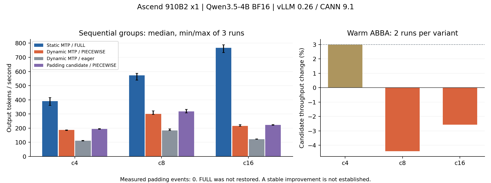

# 当前环境适用性与 0.26 对照实验

日期：2026-10-15，Asia/Shanghai。状态：原环境检查、0.26 四组 A/B、热引擎交错验证、32K/98K 显存与 profiler 对照均完成。没有验收通过的 Issue 修复，也没有稳定可归因于 padding patch 的收益。

## 原环境是否存在两个 Issue

| Issue | 原环境结论 | 直接证据与限制 |
|---|---|---|
| [#16637](https://github.com/vllm-project/vllm-ascend/issues/16637) | 当前配置不具备该动态 SD 触发条件 | 安装的 vLLM 0.22.1 没有 `num_speculative_tokens_per_batch_size` 字段；构造该配置实际抛 ValidationError。现有 Qwen3 模型没有使用该配置。不是“加补丁后修好”。 |
| [#15920](https://github.com/vllm-project/vllm-ascend/issues/15920) | 当前 Qwen3 generation 路径没有原始 dense L² mask 机制 | NPU helper 在 2,048、32,768、98,304 长度配置下均返回同一份 2,048² int8 mask，4,194,304 bytes；后两次新增分配 0 bytes。原 Issue 作者更正为 0.9.1 的 V0 路径。这不能排除其他 backend 或完整长请求的 OOM。 |

实际原环境：910B2 64GB×1，aarch64，驱动 26.1.1；Python 3.11.15、CANN/ATB 9.0.0、torch 2.10.0+cpu、torch_npu 2.10.0、vLLM 0.22.1、vLLM-Ascend 0.22.1rc1、triton-ascend 3.2.1。NPU-smi 的物理卡 ID 与容器内逻辑设备编号不同；实机 `torch.npu.device_count()==1`，使用逻辑 `npu:0`。

证据：[`current_issues_20261015.json`](../evidence/current_issues_20261015.json)，含实际源码路径及 SHA256。复现命令：

```bash
unset ASCEND_RT_VISIBLE_DEVICES
/data/vllm-ascend-env/bin/python scripts/probe_current_issues.py --output current_issues.json
```

## 对 #15920 历史补丁的更正

过去只验证 `_get_profile_max_num_reqs()` 的策略分支，错误地称之为“最小修复”。实际 `is_profile=True` 的 dummy run 没有强制 attention metadata，Ascend attention 在 metadata 为空时填零返回。改变请求数量并不执行真实长序列 attention/mask，不能证明修复原始 OOM。保留历史提交和测试数据供审计，停止将其部署或宣传为已验证修复。报告 07、README 和回归 JSON 已同步更正。

## 独立 0.26 环境与验收

沿用原驱动与设备，新 SDK 在 `/opt/vllm-project-sdk`，新 venv 在 `/root/vllm_project/envs/vllm026`，模型权重在 `/data/vllm_project/models`，日志/结果/缓存在系统盘。未修改 shell 启动文件。CANN 安装器会更新全局安装记录：原记录已保存，安装完成后恢复；旧 SDK 文件仍位于原路径。

- vLLM：官方 v0.26.0，提交 `568afb3a13806beb53bb2e6bd518269357b237c0`，`VLLM_TARGET_DEVICE=empty` 源码安装。
- vLLM-Ascend：官方 v0.26.0rc1 wheel；对应 tag checkout `f2f74a16c3c50a76f4349d807918e83edec1e35c`。已逐文件比对 installed `model_runner_v1.py` 与 tag，SHA256 同为 `4699af75ac8b4b55283d55190365e93d13820a05888bfa65aea8746deabc4d3a`。
- CANN/910B ops/ATB 9.1.0，torch 2.10.0+cpu、torch_npu 2.10.0.post4、triton-ascend 3.2.2、transformers 5.14.1、numpy 1.26.4。
- 依照[官方 Dockerfile](https://github.com/vllm-project/vllm-ascend/blob/v0.26.0rc1/Dockerfile) 使用 empty backend 和 Ascend native 包。新 venv 暂复用原环境的通用 Python 依赖；以显式 PYTHONPATH 优先导入固定 vLLM 源码，并检查实际 `__file__`，避免 editable 安装被旧包遮蔽。
- 两项目的 FastAPI metadata 约束冲突（vLLM ≥0.133/<0.137，Ascend <0.124）。当前选择 vLLM 所需 0.136.3，离线引擎通过验收；不能称为 pip check 全绿或已验收在线 API 服务。其他可选工具依赖冲突一并保存。
- 新栈 NPU matmul 通过；Qwen3-0.6B eager 生成两请求各 32 tokens 通过；Qwen3.5-4B MTP×3、FULL_DECODE_ONLY 捕获和 replay 及两请求各 32 tokens 通过。仅检查生成成功和长度，不代表语义正确性或数值等价已经完成。

模型由官方 Qwen ModelScope 仓库下载。使用 API manifest 中每个文件的 revision、size、SHA256 校验；全部文件通过。权重总大小约 9.32 GB。manifest 是每文件固定版本，不冒充统一模型 Git commit。

## #16637 实验定义

四组：动态 MTP eager、静态 MTP FULL_DECODE_ONLY、动态 MTP 原始 scheduler、动态 MTP 候选 padding patch。动态表固定 `[[1,8,3],[9,32,0]]`，BF16、TP1、seed0、greedy、ignore_eos；每组新进程，固定 prompt token IDs、长度与 admission 规则，先 warmup 后计时。

同一负载记录吞吐、TTFT 分位数、每请求平均 TPOT 分位数、NPU 峰值分配与保留显存。观测 worker 分别记录 decode 图模式选择、成功 replay、query/padded token 形状；分母是已进入 decode 且 query 不超过最大 K+1 的调度步骤，混合 prefill 单独记录。Profiler 单独运行，不用其耗时计算加速。

源码显示 patch 只影响新加入、剩一个 token 的 decode 请求，因此常规不同前缀与热前缀边界负载要区分。原 Issue 的 910B4×4、DP2×TP2、27B W8A8 吞吐不是本机的目标值；本机 910B2×1、4B BF16 的收益只能按实测报告。

**预跑发现：** 官方 0.26 的 `_maybe_override_dynamic_sd_cudagraph_mode()` 主动将 V1 动态 SD 的 FULL_DECODE_ONLY 改成 PIECEWISE；`_maybe_disable_dynamic_sd_for_data_parallel()` 在 DP>1 时禁用动态表。这是 scheduler padding 之外的配置层保护，历史报告遗漏了它。c4/c8/c16 实机预跑的 decode dispatch 为 86/49/77 次，全部 PIECEWISE，FULL 为 0。仅改 scheduler 不可能绕过这条保护。上游[PR #45953](https://github.com/vllm-project/vllm/pull/45953) 已为 V2 做多 K Full Graph 支持，V1 仍保持 PIECEWISE；不将此功能重做为原创优化。

## #16637 四组实测及否定验证

32 个请求，输入各 2,048 tokens，基础输出 256（按请求增加 0/32/64/96），每 case 输出共 9,728 tokens；连续补充请求保持指定并发。每组 3 轮，计时排除初始化及 warmup。总计 36 个常规测量 case。吞吐为 E2E output tokens/s，中位数：

| 组别 | c4 | c8 | c16 | 观测 decode 模式 |
|---|---:|---:|---:|---|
| 动态 MTP eager | 111.8 | 184.4 | 122.1 | NONE 100% |
| 静态 MTP Graph | 391.3 | 572.3 | 767.3 | FULL 100% |
| 动态 MTP 原版 | 186.6 | 300.4 | 215.1 | PIECEWISE 100% |
| 动态 MTP padding 候选 | 194.2 | 318.6 | 223.0 | PIECEWISE 100% |

最后一行的顺序分组差异为 +4.05%/+6.05%/+3.66%，**不能直接当成补丁收益**。原版/候选的 288 个对应请求 token IDs 全部相同，但 mode 没有恢复 FULL。

为排除分组顺序和热状态，另在同一个 warm engine、同一套图与权重中，以 stock→candidate→candidate→stock 交错替换 base `Scheduler.schedule()`，其他代码和可靠性保护保持一致。仅 TP1/PP1 的 uni executor 使用该实验 RPC；切换前确认方法实际属于 `vllm/v1/core/sched/scheduler.py`，保留 Ascend 的 Dyntra/Async 包装层。共 12 个追加 case：

| 并发 | 原版平均 tok/s | 候选平均 tok/s | 差异 | 实际 padding 事件 |
|---|---:|---:|---:|---:|
| c4 | 191.5 | 197.3 | +3.00% | 0 |
| c8 | 317.8 | 303.8 | −4.40% | 0 |
| c16 | 222.9 | 217.2 | −2.56% | 0 |

该普通不同前缀负载没有进入候选的 padding 分支。c4 的边界正差异不构成稳定 ≥3% 收益；c8/c16 反向，并且没有 FULL 路径恢复，停止扩大候选。CPU 多做一个 effective-K 查表/统计不能据此宣传为 NPU 优化。热引擎 c8/c16 的 request index 4 还出现输出差异，原版与原版重跑也有 1/32 不同；尚未定位批次、分块或状态因素，不将其归因于候选或称为已修复 Bug。随机/非 greedy 条件未验收。

交错探针最初两次失败，是错误选中带 `super()` 的包装方法并单独编译，丢失 `__class__` cell；它是本项目探针错误，修正为仅选择原始 base 方法后跑通。失败日志/JSON 均归档，没有计入上述性能结果。

证据：[`summary-16637.json`](../evidence/stack026/summary-16637.json)、[`summary-16637.csv`](../evidence/stack026/summary-16637.csv)、[`paired-abba.json`](../evidence/stack026/paired-abba.json)，全部逐请求记录在迁移压缩包中。候选为官方 0.26 上 13 行新增/3 行删除，原始 commit 及 Git bundle 单独保存，明确为被否定的实验。



## #16637 profiler 证据

Profiler 单独跑 c8、8 请求、2K 输入、64 基础输出，共 608 output tokens。`torch_npu.profiler` Level1/PipeUtilization、memory 记录与 CANN `msprof --export=on` 均实际执行。静态/动态 device task 时间累计约 1,695/1,705 ms，kernel 数 42,068/41,718；首次至最后 kernel 窗口中的区间并集占比为 67.3%/41.2%。Host `launch` API 次数为 13,492/23,094。

推断：该 case 的 device 计算总量相近，动态路径有更多 Host 调用和任务间空隙，与 PIECEWISE 执行成本相符。Profiler 本身有开销，区间并集不是全程设备利用率，API 时长可能重叠；这不证明所有损失都来自 Host，也不是删除同步或绕过保护的依据。

## #15920 长上下文显存及 profile 对照

Qwen3.5-4B 原生长上下文，BF16、TP1、无 MTP、eager、无 prefix cache、**chunked prefill 实际为 False**，gpu_memory_utilization=0.8。每 case 单请求 32,768/98,304 输入、16 输出，max_num_seqs=1/256。四组均成功，没有 OOM。

| 输入长度 | max_num_seqs | Init profile allocated 峰值 GiB | 分配 KV 后基线 GiB | 实际 allocated 峰值 GiB | 请求增加的峰值 GiB |
|---|---:|---:|---:|---:|---:|
| 32K | 1 | 10.616 | 46.374 | 52.404 | 6.030 |
| 32K | 256 | 10.616 | 46.374 | 52.404 | 6.030 |
| 98K | 1 | 15.870 | 41.759 | 59.832 | 18.073 |
| 98K | 256 | 15.870 | 41.760 | 59.833 | 18.073 |

这是 torch allocator allocated 峰值，reserved 另有原始记录，不能当作包含驱动/厂商所有分配的全设备 HBM 峰值。实际峰值包含 KV cache，因此要用“实际请求峰值−分配 KV 后基线”比较临时开销，不能直接用整列差异宣称 profile 漏掉几十 GiB。

**事实：** 四个 init profile 都记录 `is_profile=True, force_attention=False`，没有 attention-name device task；实际请求各有 128 个 `FusedInferAttentionScore` task。init 在 32K/98K 的 device task 累计约 0.95/2.80 秒；实际请求约 2.10/8.74 秒。改变 max_num_seqs 1→256 没有显著改变 init peak，说明历史“只改请求数”的候选仍不覆盖真实 attention 工作。

当前模型的 mask helper 探针没有命中，不能将空列表当作“所有 mask 均不存在”的证据。原环境 Qwen3 的 4 MiB mask 证据另有真实 helper 实测。这里成功的是当前 V1/Qwen3.5/0.8 组合，不是原 Issue 的 V0/Qwen2.5-14B-1M 复现；不称为 #15920 已修复。

**尚未验证：** Init 跳过 attention、真实临时增量较高，提示更高显存比例/其他 shape 的预算风险；没有实测 0.9 OOM，不能把推测当成 Bug 复现。相关社区已有 [#36598](https://github.com/vllm-project/vllm/issues/36598)（GPU GDN autotune/profile 路径）与 [#12692](https://github.com/vllm-project/vllm-ascend/issues/12692)（多卡、多模态长序列 OOM）讨论，但都不等同本机 case。继续前需对实际 GDN/FIA workspace 入口、当前主线及其修复范围重新审计。

证据：[`summary-15920.json`](../evidence/stack026/summary-15920.json)、[`profile-summary.json`](../evidence/stack026/profile-summary.json) 与原始 JSON/日志/trace。每 case 只有一个带 profiler 的请求，首次调用还可能含 Triton 编译；不把这四组 elapsed 当作吞吐 A/B 或 max_num_seqs 的提速证据。

## 归档与止损结论

两项原始触发机制未在旧安装配置中发现；新栈动态性能损失有实测，但候选 padding patch 没有解决 FULL 兼容性，也没有稳定收益；#15920 原始 V0 dense-mask OOM 没有在所测 V1 条件中复现。两份历史 patch 均不作为已验证修复部署。

已保存 fixed sources、候选 Git 对象、国内下载说明、模型 per-file manifest、依赖清单、全部 benchmark/失败日志、torch_npu 时间线/CSV 和 msprof CSV。原 0.22.1 源码 hash 与 NPU mask probe 再验收一致，原 CANN 全局安装记录已恢复，未修改驱动；新 source checkout 回到干净官方 base，NPU 无实验进程。恢复步骤见 [`stack026_reproduction.md`](../docs/stack026_reproduction.md)。
