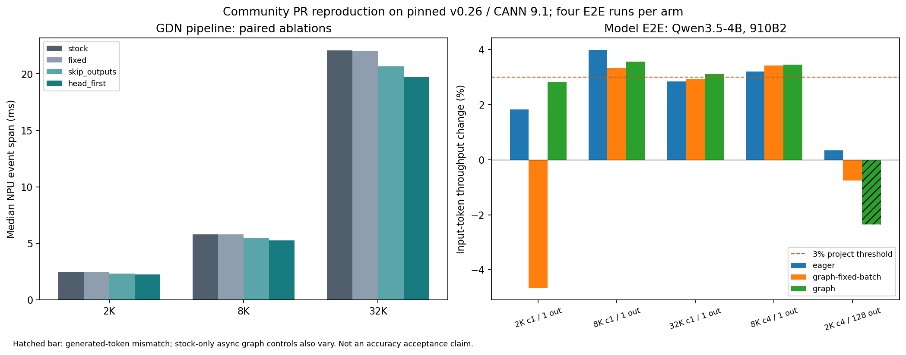

# GDN 算子优化与社区 PR 独立复现

日期：2026-10-15。硬件：单张 Ascend 910B2 64GB，当前实例物理编号 4、进程内编号 0。

背景、技术栈、实现原理和完整问题解决过程见 [技术复盘](../docs/technical_walkthrough.md)；本报告保留对应实验的精确结果与边界。

## 本轮结论

完成一个实机 Bug 修复复现和一个有明确适用区间的性能复现。**不作为原创 GDN 算法或“社区没有想到”的优化。**

1. **等长 WY 索引 Bug：** 未修改的 0.26 kernel 在 `cu_seqlens=None` 时不能编译；批次索引和转置后 gate/beta 的批次偏移也有错误。按社区 [#14333](https://github.com/vllm-project/vllm-ascend/pull/14333) 回移后，独立矩阵参考的 24 个 shape/dtype 用例通过。实际 Qwen3.5 模型走 packed 路径，所以不能将此 Bug 修复说成模型吞吐收益来源。
2. **GDN 布局优化：** 复现 [#16538](https://github.com/vllm-project/vllm-ascend/pull/16538) 及重叠的 [#16524](https://github.com/vllm-project/vllm-ascend/pull/16524)，由 Triton WY 直接产生 AscendC 消费的 head-first `w/u`，并跳过不会返回的 `h/v_new` 布局转换。32K 单层流水线 event 测量跨度从 22.058 ms 降至 19.693 ms，耗时降低 10.73%（速率提升 12.01%）。8K 模型 prefill 的多组独立环境内 A/B 吞吐收益约 **3.2%–4.0%**。
3. **适用范围有限：** 2K 短请求没有稳定收益，其中一轮固定 batch 对照回退 4.66%；长 decode 没有稳定收益。没有将补丁替换为默认生产实现。默认异步图模式的生成结果存在基线自身波动，不能据此声称已修复图模式精度问题。

代码：修复 `71d87b70a81e4d6ab492907936cf34dead2f4f6c`；性能 `140d8dfe4a59930f3f41d05574e198419e0f4807`。补丁、增量 bundle、原始结果与恢复命令见 [复现说明](../docs/gdn_operator_reproduction.md)。

## 源码搜索 → Issue/PR → 主线 → 实验

生产基线固定为 vLLM `568afb3a13806beb53bb2e6bd518269357b237c0`、vLLM-Ascend `f2f74a16c3c50a76f4349d807918e83edec1e35c`，分别对应 0.26.0 / 0.26.0rc1。Python 3.11.15、torch 2.10.0+cpu、torch-npu 2.10.0.post4、Triton Ascend 3.2.2、CANN/ATB 9.1.0。模型使用已下载的 Qwen3.5-4B BF16；权重逐文件版本与哈希沿用 `evidence/stack026/qwen35-modelscope-files.json`。

GitHub 当前主线核对固定在 `f73001e0b9b82419d34eb23919a5eef8e6018682`。Gitee 镜像的 main 较旧，另行抓取 GitHub 固定提交的 `wy_fast.py` / `chunk.py` 做比对。源文件快照、SHA、检索原文、PR base/head SHA 及状态保存在 `evidence/gdn_operator/upstream-audit.json` 与同目录文件中；主线源码核对不等同于在主线依赖组合上完成 NPU 测试。

| 候选 | 社区覆盖 / 当前主线 | 决定 |
| --- | --- | --- |
| WY 等长索引修复 | #14333 open，未合并；核对主线仍有旧索引 | 复现 Bug 与修复，明确来源 |
| WY 直接输出 head-first / 不返回的中间值无需转换 | #16538、#16524 open，未合并；当前核对文件仍保留原转换 | 在匹配 0.26 栈组合移植并消融 |
| GDN 预处理融合与减少 host 发射 | #16811、#17604 open；另有 #12142 的较大布局/AscendC 方案 | 已有社区方案，避免重复宣称原创 |
| 更大范围 GDN 融合 | #8872 MegaGDN / PTO open；#12647 fused CANN 路径已合并 | 不从零重写；本轮不引入另一套完整 kernel |
| chunk/head 任务重新划分 | 阅读 #8386 grid 适配及 #7597 FLA 优化 diff，未在所查 diff 中发现本轮拆分方式的等价实现 | 做一个隔离实验；性能不足，止损 |

检索也查看了 #14576 的已关闭 draft。搜索无法证明不存在未索引、私人或其他仓库中的等价实现；head 并行本身也是通用手段，不是算法创新。

调用路径限定在 `vllm_ascend/ops/gdn.py:_forward_core`（第 149 行，prefill 调用在第 404 行），其第 33 行直接导入 `ops/triton/fla/chunk.py` 的 `chunk_gated_delta_rule` → `chunk_gated_delta_rule_fwd`：cumsum → KKT → solve-tril → `wy_fast.py:recompute_w_u_fwd` → 现有 AscendC `chunk_gated_delta_rule_fwd_h` → `chunk_fwd_o` → 输出布局转换。KKT/solve 内部也使用 device adaptor 选择硬件实现；本次 GDN prefill 的入口没有绕到另一套 fused CANN 路径。decode 的 recurrent 算子没有被替换。

## 先做的独立优化实验及止损

原 WY 在每个 chunk 内用 `for i_h in range(H)` 串行遍历 head。实验版本只把 head 展开到 launch grid；等长索引修复与该改动分开。

| Packed 长度 | 基线 event span ms | head 并行 ms | 结果 |
| --- | ---: | ---: | --- |
| 128 | 0.3806 | 0.3836 | 略慢 |
| 2048 | 0.4690 | 0.4642 | 未达门槛 |
| 8192 | 1.5538 | 1.5400 | 未达门槛 |
| 32768 | 5.8477 | 5.8148 | 未达门槛 |

每个长度四轮交错测量，每轮五次调用；H=32、Hg=16、K=V=128，输出与基线逐元素相同。event span 包含 host 发射间隙，不能称为纯 kernel 耗时。没有将这些亚 3% 的差别包装为稳定收益。数据见 `geometry-screen.json`。

## 正确性与消融

- `wy-layout-correctness.json`：24 个用例 × stock/fixed/parallel/head-first。覆盖 BF16/FP32、1/65 token、`[31,0,97,1]` ragged/空段、B=2/T=96 等长、K/V=64/64、128/128、32/96。参考实现是独立 CPU 分块矩阵乘。stock 的六个等长用例失败，其余通过；修复版本和 head-first 版本均通过全部 24 个用例。
- `gdn-pipeline.json`：完整 GDN 在官方 metadata builder 生成的 `[64]`、`[64,128]` 上，与独立 CPU FP32 递推参考比较输出和最终 state；四个版本共八项均通过，最大绝对误差不超过约 `4.10e-5`，输入 state 没有被修改。
- 2K/8K/32K 的完整 GDN 输出和最终 state，在所有消融版本间逐元素相同。
- 源码 bundle 在新 worktree 恢复后执行独立 NPU pytest，12 个参数化测试通过；另检查 `SUPPRESS_LEVEL=0/3` 的返回布局，四个版本共八项全部逐元素一致。验收日志与结果单独保存。
- PCP>1 的路径保留 seq-major；本机只有单卡，未将代码 guard 检查冒充多卡实机验证。

| 输入长度 | stock ms | 仅等长修复 ms | 仅跳过无用转换 ms | 组合 head-first ms |
| --- | ---: | ---: | ---: | ---: |
| 2048 | 2.432 | 2.435 | 2.329 | 2.250 |
| 8192 | 5.788 | 5.795 | 5.442 | 5.251 |
| 32768 | 22.058 | 22.017 | 20.655 | 19.693 |

每个版本六轮交错测量，每轮三次调用；H=32/Hg=16、Dk=Dv=128、BF16，初始化与首次编译排除。没有通过降低精度取得收益。表中是 NPU event span，不是 kernel duration 求和。

## 为什么有收益：原生 profiler 证据

`torch_npu.profiler` 采集 CPU/NPU、shape、memory 和 Level1/PipeUtilization；再对原生 PROF 目录运行 `msprof --export=on`。32K pipeline 每组均记录三次完整调用：

| 原生设备指标（三次调用合计） | stock | head-first |
| --- | ---: | ---: |
| kernel task 数 | 72 | 60 |
| transpose 数 | 36 | 24 |
| transpose 累计时间 | 10.055 ms | 3.110 ms |
| WY kernel 累计时间 | 17.132 ms | 17.157 ms |
| 全部 kernel duration 求和 | 65.425 ms | 58.459 ms |

每次调用少四个 transpose，WY 数学计算耗时基本相同，因此收益主要来自减少数据搬运。按 profiler 的 BF16 shape 计算，被消除的 `w/u/v_new` 各 256 MiB、`h` 512 MiB，合计每层 1.25 GiB 的复制输出；按读写各一次估算约 2.5 GiB 流量。这是基于 shape 的流量估算，不是 HBM 总线计数实测。

已有 profiler 的 RECORD 结束警告保留在日志；设备表中每组三个 WY、三个 H、三个 O 等任务完整，结构变化与源码消融一致。未将 kernel 时间求和当作模型 wall time，也未把局部流水线提升直接外推到整模型。

模型级的 8K 输入 / 8 输出 profile 也给出同样结构证据：stock/head-first 均有 24 次 WY，transpose 从 528 次降至 432 次，正好每个 GDN 层少四次；transpose 累计时间从 25.562 ms 降至 11.717 ms，全部 kernel duration 求和从 504.800 ms 降至 490.512 ms。该段包含 profiler 扰动，不作为吞吐样本；它用于验证算子变化确实传递到整模型。

## 模型 E2E：全部收益与回退点

共同设置：Qwen3.5-4B BF16，TP=1、PCP=1，max_model_len=33024、max_num_batched_tokens=32768、max_num_seqs=8、显存比例 0.8，prefix cache 关闭、chunked prefill 开启，无 MTP/量化/图像视频；greedy、seed=0、ignore_eos=True。每个 engine 内先预热 stock/head-first 的所有 shape，再执行 A B B A B A A B，每个负载每组四次。吞吐为相同工作量的 token/s 中位数之比。

| 输入 / 并发 / 输出 | eager 默认异步 | FULL_DECODE_ONLY 默认异步 | FULL_DECODE_ONLY 固定批次/同步 |
| --- | ---: | ---: | ---: |
| 2K / 1 / 1 | +1.83% | +2.81% | **−4.66%** |
| 8K / 1 / 1 | +3.99% | +3.56% | +3.32% |
| 32K / 1 / 1 | +2.85% | +3.11% | +2.93% |
| 8K / 4 / 1 | +3.21% | +3.46% | +3.43% |
| 2K / 4 / 128 | +0.34% | **−2.35%** | **−0.76%** |

表中按 `summary.json` 原始百分比直接保留两位；本次文档核对将先保留三位再四舍五入造成的 `3.33%` / `0.35%` 分别统一为 `3.32%` / `0.34%`，实验数据未改动。

输出长度为 1 的行用于 prefill/首 token 研究，不能宣传为一般 decode 吞吐收益。固定批次组关闭 async scheduling，并使用 upstream 的单进程 engine 控制请求全部入队后再执行；只在该组内比较 A/B，不把关闭异步带来的速度变化算作算子收益。其 8K c1/c4 的 TTFT 分别降低 3.23%/3.35%。原 eager/异步 graph 记录没有请求 metrics，`ttft_s=null`，只报告 workload wall time。

每组四次仍属于有限样本，短负载波动明显。2K 固定批次的 wall time 范围约 0.182–0.213 s；保留回退，不以重选最佳点或改定义掩盖。未完成 SLA、P99、长时间稳定性或八并发收益验收。

### 生成差异的对照

eager A/B 的 88 个请求全部 token 相同。默认异步 graph A/B 的 88 个请求中，head-first 有一个 128-token 请求与首个 stock 结果不同；第七个生成 token 开始分叉，第一 token 的部分 logprob 也不同。

随后以相同异步 graph 配置仅运行 stock 八轮，八个长 decode workload 的 request 0 中有七轮与首轮不同。进一步逐 token fingerprint 比较发现，**先前被视为 candidate 差异的完整输出，也由未修改 stock 独立生成**。因此不能断定是布局引入的精度回退，也不能反过来说已证明默认异步数值稳定或已解决该问题。请求入队/实际 batch 变化只是待验证解释；本轮没有改 scheduler 来强行消除差异。

固定批次/同步图模式的 88 个请求全部 token 一致；完整 GDN 的独立数值参考也通过。默认异步 graph 的差异保留为限制和后续观察项，不归类为原创 Bug 修复。相关数据为 `engine-graph.json`、`graph-baseline-control.json`、`engine-graph-fixed-batch.json`。

## 工作量与技术栈

实际工程包括：官方 release 与当前主线/PR 去重；Triton Ascend 指针与 B/H/T 布局；等长修复与性能 PR 的组合兼容；现有 AscendC H/O 算子的布局 ABI 对接；独立 CPU 数学参考、NPU shape/dtype 回归；vLLM worker collective RPC 与固定批次控制；NPU events、torch_npu profiler、msprof 原生导出、PipeUtilization；全量 A/B/消融/负向结果；Git 两个源码提交、bundle、校验与恢复。

实际修改的是 WY 和 chunk 两个源码文件及针对性测试，没有重写 GDN/Attention，也没有宣称编写了新的 AscendC 数学算子。工程价值主要是可审计移植与独立验证。

## 遇到的失败与止损

初始独立 GDN 测试没有初始化 Triton device properties，补齐官方初始化。另一个 T=1/无 prebuilt metadata 的基线调用触发 AICore 越界，后查社区 #14192 存在相关报告；本轮未分离 shape 与 metadata 两个因素，不能说定位或修复了该崩溃。性能基线改为双方都使用模型路径的官方 metadata builder 及合法形状。生成实验模块时一次锚点误匹配 KKT 参数，已修正为只在 WY 调用内注入关键字。首次开启 metrics 的脚本用了旧字段，按固定 0.26 源码改为 `RequestStateStats.first_token_latency`，失败运行零个测量 case；独立 contract 脚本也补齐官方 custom-op bootstrap。上述均保留日志，不计入性能样本、不宣传为框架 Bug。

head 并行实验已经止损。布局复现达到部分代表性 prefill 负载 3% 门槛，但不作为所有负载的默认优化。等长 WY 的单独 Bug 修复可以独立审阅/复现；所有结果仍仅限上述单卡与模型/版本组合。

## 迁移与下阶段最小任务

源码两提交、补丁及 bundle 保存在 Git；原始 benchmark、失败日志、Torch/MSProf 的 CSV/timeline 选定导出另作带 SHA256 manifest 的归档。归档共 244 个成员（172 个记录/日志/实验模块，72 个 profiler 导出），在 Linux 新目录完整恢复，Windows 也验证归档哈希并恢复轻量记录。源码 bundle 在 Windows 独立 checkout 导入，在 Linux 恢复 worktree 上通过 NPU 测试。依赖/SDK/权重重新从固定版本与国内源获取；权重不进入 Git。

GitHub 拒绝直接创建带上游 workflow 历史的源码分支，因为当前凭据缺少 workflow scope；没有创建该远端源码分支。完整增量提交通过研究分支中的 bundle 和补丁保存，无需调整 workflow 权限即可恢复。运行结束时 NPU 无运行进程，已安装基线文件保持原始版本，生产 checkout 干净。

若继续完善这一复现，下一步应是扩大 8K prefill 的独立会话样本，并针对短请求波动和异步图模式的 batch/首 token logits 做专门对照。只有找到确定根因或稳定适用范围后，才考虑默认启用或向上游提交。
